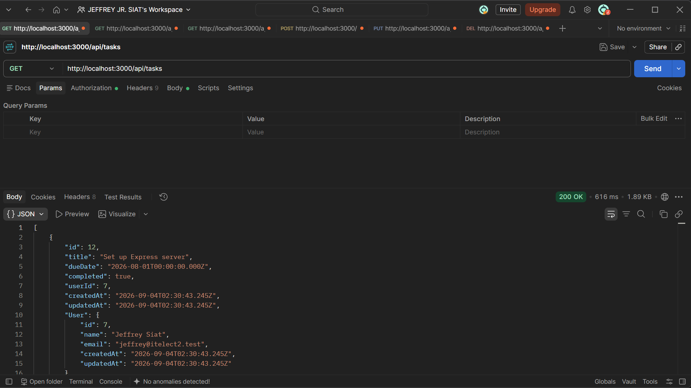
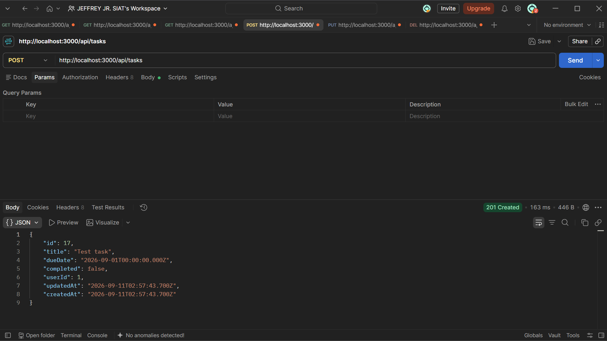
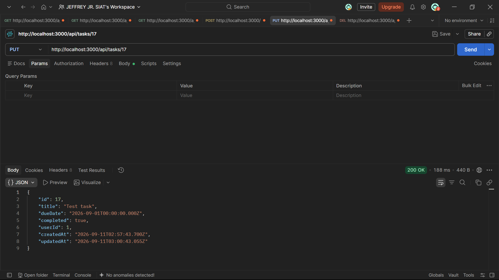
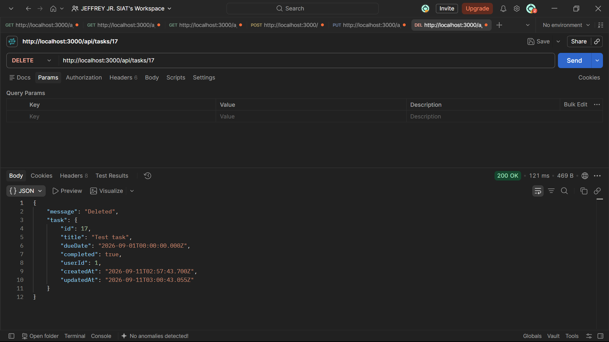

# itelect2-project
My IT Elective 2 backend web development project.

## Live URL
https://itelect2-tasks-api.onrender.com

Try it: https://itelect2-tasks-api.onrender.com/api/tasks

> Hosted on Render's free plan. The first request after a period of
> inactivity may take up to a minute while the service wakes up.

## API Testing

